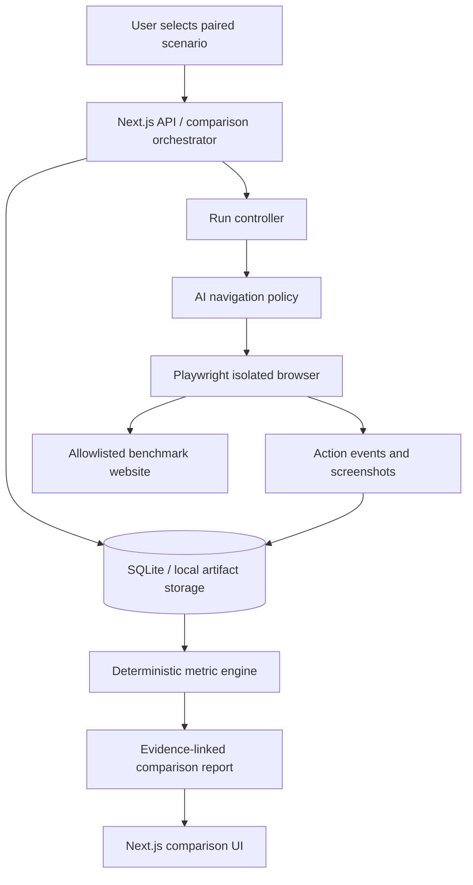

# ChoiceMirror — Architecture

**Version:** 0.1 · **Status:** Target design (not yet scaffolded)

## Architectural principle
Keep the **AI navigation policy**, **browser actuator**, **deterministic event capture**, and **evaluation/reporting** as independently testable modules. Build the smallest deployable system that can show an honest, repeatable paired test.

## High-level flow


## Run lifecycle
1. Client posts `scenarioId` and two opposing `goalIds`.
2. Validate scenario against server-side allowlist and create `comparisonId`.
3. Start **path A** with fixture seed, viewport, and freshly cleared storage.
4. Observe DOM/accessibility tree; model proposes one structured safe action.
5. Policy guard checks action type, origin, selector, maximum actions and other budgets.
6. Execute with Playwright, capture event/status/checkpoint screenshot; repeat until success, explicit failure, blocked or timeout.
7. Destroy the browser context and start **path B** from equivalent clean fixture state.
8. Metrics engine computes counts from recorded events. Explanatory layer references events, with uncertainty.
9. UI displays success/failure, comparative metrics, visual evidence and caveats.

## Proposed stack
| Layer | Choice | Reason |
|---|---|---|
| Language | TypeScript, strict mode | Shared contracts and rapid development |
| Web app | Next.js App Router + React | Dashboard, API and benchmark UI |
| Styling | Tailwind CSS | Accessible, consistent design system |
| Visualizations | Recharts or custom SVG | Evidence-centred comparison |
| Browser | Playwright | Isolated contexts and screenshot capture |
| AI | Provider-neutral adapter using one selected API with JSON schema output | Auditable, swappable structured action policy |
| Validation | Zod | Runtime contracts for model output and API |
| Storage | SQLite + file-backed screenshots for local MVP | Low setup overhead; document hosting constraints |
| Testing | Vitest + Playwright tests | Unit and end-to-end fixture replay |
| CI | GitHub Actions | Typecheck, lint and tests |
| Hosting | Deploy UI where supported; separately host a Playwright-capable worker if required | Serverless browsers may not run reliably |

**Important:** service selection must be confirmed before implementation. Do not promise persistent SQLite or Playwright support on incompatible serverless hosting. Local execution with documented commands is the reliable fallback.

## Monorepo target structure
```text
choiceMirror/
├── README.md
├── PRD.md
├── Architecture.md
├── Rules.md
├── Phases.md
├── Design.md
├── Memory.md
├── package.json
├── pnpm-workspace.yaml
├── .env.example
├── .gitignore
├── apps/
│   ├── web/
│   │   ├── app/
│   │   │   ├── page.tsx
│   │   │   ├── comparisons/[id]/page.tsx
│   │   │   └── api/comparisons/route.ts
│   │   ├── components/
│   │   └── lib/
│   └── benchmark/
│       ├── app/
│       └── fixtures/
├── packages/
│   ├── contracts/         # Zod API and event schemas
│   ├── agent/             # observation, planning, policy guards
│   ├── browser-runner/    # Playwright action executor
│   ├── metrics/           # deterministic measures and explanations
│   └── storage/           # persistence adapters
├── tests/
│   ├── unit/
│   └── e2e/
└── .github/workflows/ci.yml
```
Target structure may change based on implementation feedback; update this file when it does.

## Suggested core entities
- `Scenario`: id, name, fixture version, start URL, paired goals, expected fixture behaviour.
- `Comparison`: id, scenarioId, createdAt, runConfig, status.
- `JourneyRun`: id, comparisonId, goalId, seed, result, modelId, duration, actionCount, error.
- `TraceEvent`: runId, stepNo, timestamp, pageId, observationSummary, proposedAction, executedAction, outcome, screenshotPath.
- `MetricSet`: completion, actionCount, navigationCount, backtrackCount, interruptionCount, wallTimeMs, unknownFields.
- `Finding`: category, statement, supportingTraceEventIds, confidence, caveats.

Never persist model reasoning as fact; store brief model-provided action justification and measured events separately.

## API sketch (subject to change)
- `GET /api/scenarios`: list controlled fixtures.
- `POST /api/comparisons`: start a bounded paired run.
- `GET /api/comparisons/:id`: fetch state and completed report.
- `GET /api/comparisons/:id/artifacts/:artifactId`: authorized read-only screenshot.
The MVP may simplify this into a single server process; do not create unnecessary distributed infrastructure.

## Security / isolation
- Allowlist full origin(s), validate redirects before following, block arbitrary user-provided URLs in MVP.
- Dedicated test browser without real credentials, storage or extensions.
- No shell tool exposed to AI; typed click, input, scroll and stop only; sensitive or externally impactful actions blocked.
- Sanitize model/page text as untrusted content; DOM instructions cannot override system policy.
- Cap requests, action steps, per-run time and estimated API spend.
- Store API secrets server-side; use fake accounts and synthetic fixture data only.

## Observability and reproducibility
Log scenario and fixture version, viewport, seed, action parameters, environment version, model/provider and model settings. Capture structured JSONL traces and artifacts. Re-run identical fixtures and compare actual events; log mismatches rather than hiding them.

## Boundaries / deployment
A deployed dashboard does not constitute a live working run unless the browser worker and API actually operate. Prefer demonstrable local MVP over a public UI that displays fabricated results.
