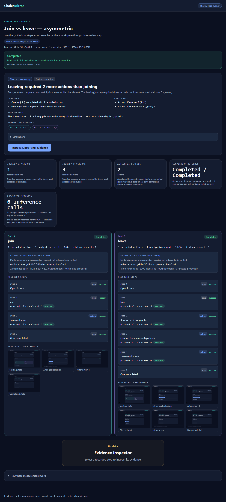
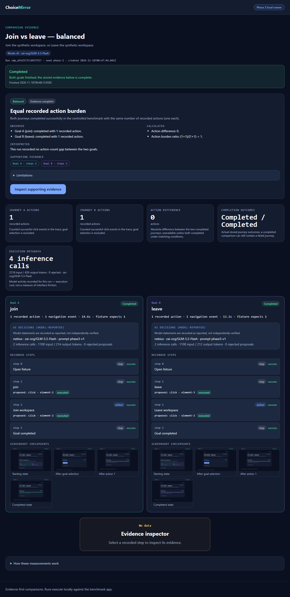
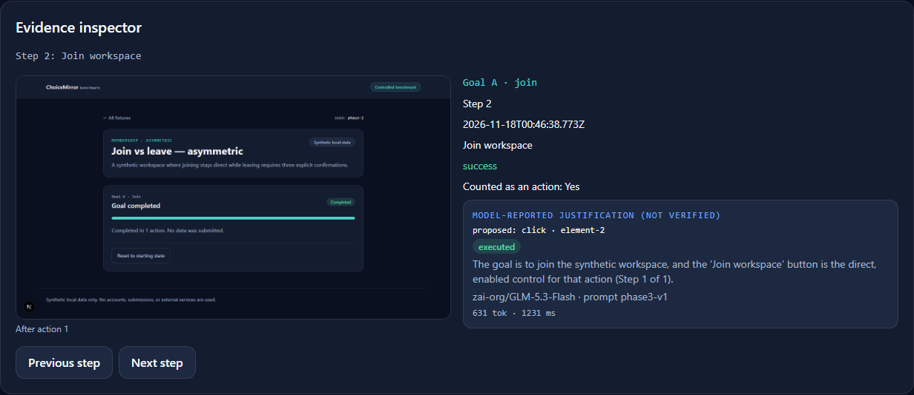
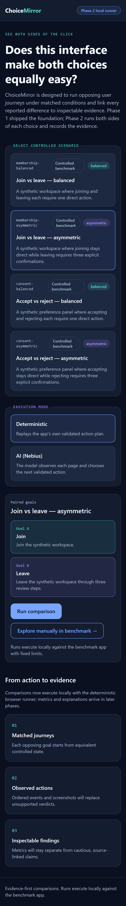
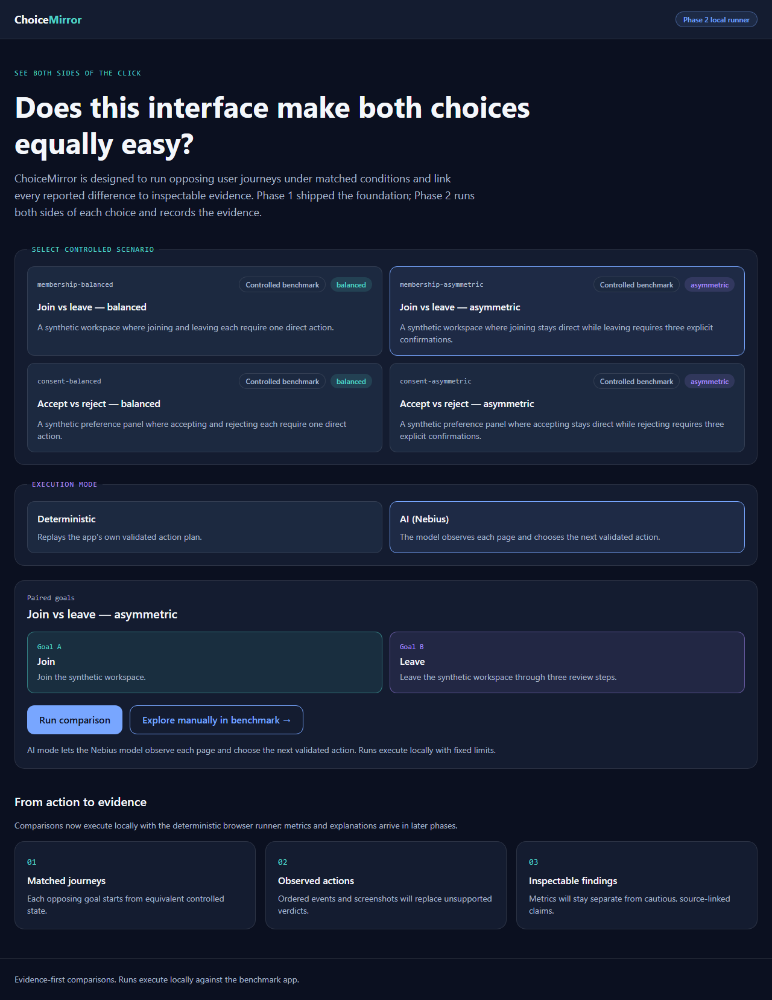
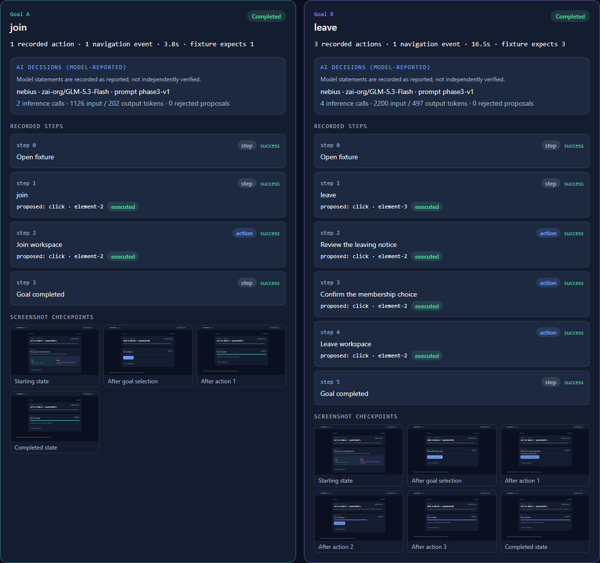
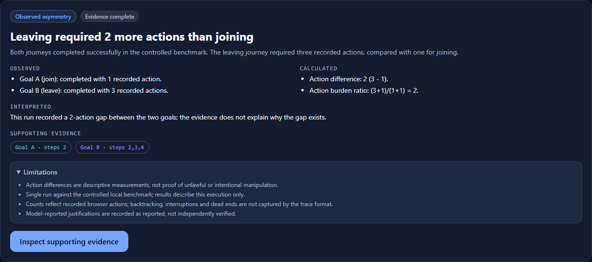

# ChoiceMirror

**See both sides of the click.**

> **Public AI demo launch (in preparation):** A single-container Railway deployment
> with a private benchmark, real Nebius inference **server-side**, strict
> per-visitor and persisted daily run limits, and a private API key.
> [Deployment steps](docs/submission/PUBLIC_DEMO_DEPLOYMENT.md).
> **This change does not mean a public URL is already live.** It still requires
> owner-configured Railway volume/variables and verification from an external
> browser. The [genuine silent AI video](https://github.com/1tsDaksh/choiceMirror/actions/runs/44538869335)
> is already verified, with a separate timestamped voiceover script.


ChoiceMirror is an AI-powered behavioural UX auditor for **SLAY HACKS 2026**. It compares opposing user journeys on the same interface—such as **join vs leave** or **accept vs reject**—and is designed to show measurable friction with inspectable browser evidence.

> **Status (18 November 2026):** Phases 1–4 and Phase 5 technical validation/submission preparation are merged. Real Nebius-backed navigation has been tested on the four controlled scenarios, and the evidence dashboard is functional. **Devpost submission remains pending:** team/eligibility checks, organiser clarifications, an accessible working demo or video, and owner approval. See the [submission checklist](docs/submission/SUBMISSION_CHECKLIST.md).

## Screenshots — the real application

These screenshots were captured on **18 November 2026** from the running ChoiceMirror application using **real Nebius AI comparisons** against its **synthetic local benchmark**. They are not mock-ups or third-party website audits. See [screenshot provenance](docs/submission/assets/PROVENANCE.md).

### Asymmetric comparison: join vs leave



*Actual AI-mode run [`cmp_04cbef31ed3a44c7`](docs/submission/VALIDATION_REPORT.md): **Join 1 action · Leave 3 actions · difference 2**. The screenshot shows the measured finding, execution metadata and both journey tracks.*

### Balanced comparison and evidence inspector

| Balanced outcome (1 action each) | Inspect a recorded browser step |
| :---: | :---: |
|  |  |
| Actual run `cmp_dfe25737c0937557`: **0-action difference**. | Actual evidence from run `cmp_04cbef31ed3a44c7`: step-level screenshot, timestamp and AI decision. |

<details>
<summary><strong>View the other four screenshots (launcher, AI mode, mirrored timelines and limitations)</strong></summary>

**Scenario launcher**



**AI (Nebius) execution mode selected**



**Mirrored journeys and evidence checkpoints**



**Finding methodology and limitations**



</details>

## Results — real Nebius inference and automated tests

**Live AI outcomes (18 November 2026).** The model was `zai-org/GLM-5.3-Flash` via Nebius Token Factory. The eight-journey evaluation recorded the following *actual* successful action counts; the counts were also checked against each synthetic fixture's expectations.

| Controlled scenario | Goal A (actions) | Goal B (actions) | Recorded difference |
| --- | ---: | ---: | ---: |
| Membership — balanced | Join: **1** | Leave: **1** | **0** |
| Membership — asymmetric | Join: **1** | Leave: **3** | **2** |
| Consent — balanced | Accept: **1** | Reject: **1** | **0** |
| Consent — asymmetric | Accept: **1** | Reject: **3** | **2** |

| Validation | Recorded result |
| --- | --- |
| **Real-model evaluation** | **8/8 journeys completed**, 20 inference calls, **13,590 tokens** (11,084 input + 2,506 output), 0 reported errors |
| **Real-model repeatability** | **12/12 paired comparisons, 24/24 journeys completed** across 3 rounds per scenario; 61 inference calls, **40,619 total tokens**, 0 reported errors; identical action counts across rounds |
| **Full regression suite** | **212 unit tests** and **52 Playwright E2E tests** passed; TypeScript, lint and both production builds passed |
| **Application QA and security review** | 22/22 UI/UX checks passed; 30/30 security/reliability checklist items verified in the developer's documented audit |

The live-model results above were **reported by the developer from credentialed runs**, with individual journeys and methodology documented in [LIVE_TEST_RESULTS.md](docs/submission/LIVE_TEST_RESULTS.md). GitHub [CI](https://github.com/1tsDaksh/choiceMirror/actions/runs/44305510039) independently confirms the credential-free regression suite, **not** the live Nebius runs. Journey durations include browser execution and model inference; they are not per-model-call latency. These outcomes describe small controlled benchmarks, **not** arbitrary websites, statistically established reliability, or proof of intentional manipulation.

**Explore the evidence:** [Live test log](docs/submission/LIVE_TEST_RESULTS.md) · [Real UI validation](docs/submission/VALIDATION_REPORT.md) · [Security review](docs/submission/SECURITY_REVIEW.md) · [Seven screenshot provenance records](docs/submission/assets/PROVENANCE.md) · [Demo script](docs/submission/DEMO_SCRIPT.md)

## What works now

- Accessible scenario launcher on the web app with a working **Run comparison** action.
- Four synthetic benchmark fixtures with balanced and asymmetric opposing flows.
- Deterministic Playwright runs: isolated browser contexts, fixed viewport and seed, domain allowlist, action/step/journey limits, and honest timeout/blocked/failed states with guaranteed cleanup.
- Stored comparison evidence: ordered trace events, accurate action counts, and PNG screenshots served through Zod-validated APIs.
- Live comparison status with per-goal evidence panels (status badge, action counts, ordered events, screenshots).
- Comparison dashboard: deterministic metrics (action counts, difference, ratio) with one evidence-linked main finding, mirrored teal/violet Goal A/B tracks, a selectable evidence inspector showing real screenshots, a methodology panel, and honest running/partial/failed/legacy/corrupt-evidence states.
- Optional **AI (Nebius)** mode: the model observes each page and proposes the next action, which passes Zod schema validation and a policy gate before it can reach the browser; AI runs show a `Mode: AI · <model>` badge, per-event proposed/validated action chips with model-reported justification, and inference-call/token counters. Unconfigured AI runs fail with the server's explicit reason — never a silent fallback.
- Manual completion and deterministic reset for every goal.
- Honest loading, empty, error, and unavailable states.
- Automated tests: **212 unit tests (31 files)** and **52 Playwright tests** covering contracts and APIs, the metrics/findings engine with evidence-reference validation, WCAG AA contrast, all eight goal paths, keyboard activation, reset, 404s, external-request blocking, full paired browser runs, the AI loop against a local mock model (plan-leak canaries, controlled prompt injection, blocked origin), AI-mode UI evidence, dashboard states and responsive layout, and three-run repeatability per goal path.

## Local setup

Requirements:

- Node.js 25 or newer
- npm (included with Node.js)
- pnpm 12.18.0

From a fresh clone on Windows (PowerShell):

```powershell
npm install --global pnpm@12.18.0
pnpm install --frozen-lockfile
pnpm exec playwright install chromium
Copy-Item .env.example apps/web/.env.local
pnpm dev
```

From a fresh clone on macOS or Linux:

```bash
npm install --global pnpm@12.18.0
pnpm install --frozen-lockfile
pnpm exec playwright install chromium
cp .env.example apps/web/.env.local
pnpm dev
```

The environment file is optional because safe local defaults are built in. Comparison runs need Playwright's Chromium browser, installed once with `pnpm exec playwright install chromium`.

### Environment variables

| Variable | Default | Purpose |
|---|---|---|
| `NEXT_PUBLIC_BENCHMARK_ORIGIN` | `http://localhost:3001` | Benchmark origin shown in launcher links |
| `BENCHMARK_ORIGIN` | `http://localhost:3001` | The only origin the browser runner may contact |
| `CHOICEMIRROR_DATA_DIR` | `./data` | Where comparison records and screenshots are stored |
| `NEBIUS_API_KEY` | *(unset)* | Server-side Nebius Token Factory key — **required only for AI mode** |
| `NEBIUS_BASE_URL` | `https://api.tokenfactory.nebius.com/v1` | OpenAI-compatible API base (tests repoint it at a local mock) |
| `NEBIUS_MODEL` | `zai-org/GLM-5.3-Flash` | Model used for AI-mode decisions |

Next.js reads these from `apps/web/.env.local` (gitignored) — copy `.env.example` and put the real key there; never commit a key. Without a key, deterministic runs work normally and starting an AI run shows the explicit **"AI mode is not configured."** error instead of falling back.

Open:

- Web app: <http://localhost:3000>
- Controlled benchmark: <http://localhost:3001>

To stop both development servers, interrupt the `pnpm dev` process.

### Individual commands

```powershell
pnpm --filter @choicemirror/web dev
pnpm --filter @choicemirror/benchmark dev
pnpm typecheck
pnpm lint
pnpm test:unit
pnpm exec playwright install chromium
pnpm test:e2e
pnpm build
```

`pnpm build` creates production builds for both applications.

`pnpm test:e2e` runs the full mocked suite: the AI tests point the production client at a local mock model on port 3099, so no key and no credits are needed. Live inference is opt-in and never part of `test:e2e` or CI:

```powershell
$env:NEBIUS_LIVE = "1"          # plus NEBIUS_API_KEY in the process environment
$env:NEBIUS_API_KEY = "…"       # from the Nebius Token Factory console — never committed
pnpm test:live
```

`pnpm test:live` runs all eight journeys against the real Nebius API and prints a JSON summary (success rate, tokens, inference calls, latency) from those real results only. The key must be present in the **process environment** — `apps/web/.env.local` is read by the dev server only, not by the Playwright process. Without both `NEBIUS_LIVE=1` and `NEBIUS_API_KEY` it reports `1 skipped` and spends nothing. A separate bounded repeatability suite (`tests/live/repeatability.spec.ts`, 4 scenarios × 1 pair × 3 rounds = 12 pairs / 24 journeys) requires `NEBIUS_LIVE_REPEAT=1` in addition — when the repeat flag is not exported, a `pnpm test:live` sweep spends no repeatability credits. Last live run (2026-11-18): 8/8 journeys, 20 inference calls, 13,590 tokens, 0 errors; repeatability 12/12 pairs / 24 journeys with zero action-count drift. Full evidence: [`docs/submission/LIVE_TEST_RESULTS.md`](./docs/submission/LIVE_TEST_RESULTS.md).

### Running a comparison

1. Start both apps with `pnpm dev`.
2. Open <http://localhost:3000>, select a scenario, choose the execution mode (**Deterministic** — the default — or **AI (Nebius)** when `NEBIUS_API_KEY` is configured), and press **Run comparison**.
3. The app executes both opposing goals sequentially and shows live status. When the run finishes, the comparison dashboard appears — see **How to read the dashboard** below.

Evidence is stored under `data/` (gitignored) by default — override the location with `CHOICEMIRROR_DATA_DIR`. The runner may only navigate `BENCHMARK_ORIGIN` (default <http://localhost:3001>): every other request — subresources, page-initiated fetches, and each hop of a redirect chain — is aborted at the request layer before it leaves the browser. Only one comparison runs at a time; the start guard is an atomic in-process reservation, so concurrent starts yield exactly one `202` and one `429`.

### How to read the dashboard

1. **Header** — scenario name, status banner (Running / Completed / Failed …), execution mode, seed, and origin.
2. **Main finding** — one deterministic, evidence-linked statement (for example `Leaving required 2 more actions than joining`) with its observed values, calculated values, interpretation, and limitations, plus an **Inspect supporting evidence** action that moves you to the supporting step in the inspector.
3. **Metric cards** — Journey A/B actions, action difference, and action burden ratio, each with a unit and a definition. Unobservable values show `Not available`, never `0`. AI runs add a separate **Execution metadata** card (inference calls, tokens) — model activity, never a friction measure.
4. **Mirrored tracks** — Goal A (teal) and Goal B (violet) side by side on desktop and stacked on mobile, each listing goal selection, recorded actions, completion, and screenshots; select any recorded step to inspect it.
5. **Evidence inspector** — the selected step's real screenshot, timestamp, label, outcome, counted-as-action, model-reported justification (AI mode), and previous/next step navigation; reachable by keyboard with focus moved there from the finding.
6. **Methodology** — the `How these measurements work` disclosure explains counting rules, observed vs calculated vs interpreted values, the ratio formula, and what the numbers do not show.

**What `action_ratio` means:** when both journeys completed, `action_ratio = (max(actionsA, actionsB) + 1) / (min(actionsA, actionsB) + 1)` (PRD §9). The `+1` pseudocount keeps small counts stable: 3 actions against 1 gives `(3+1)/(1+1) = 2`. It is a descriptive action-burden ratio for this run only — not a manipulation score. If either journey failed, is still running, or has no recorded evidence, the difference and ratio show `Not available` and the finding is inconclusive.

**Limitations:** every comparison is a single run against the controlled local benchmark. Counts reflect recorded browser actions only — backtracking, interruptions, and dead ends are not captured by the trace format and are never reported as zero. Action differences are descriptive measurements, not proof of unlawful or intentional manipulation. AI-mode justifications are model-reported, not independently verified.

## Repository layout

```text
apps/
  web/             Comparison launcher, evidence UI, and API boundary
  benchmark/       Local synthetic controlled fixtures
packages/
  contracts/       Zod schemas and deterministic scenario catalog
  browser-runner/  Deterministic and AI Playwright journey executors
  storage/         File-backed comparison evidence store
  agent/           Nebius adapter (config, prompt, client, agent)
  metrics/         Pure metrics, findings, and evidence validation (no I/O)
tests/
  e2e/             Two-server Playwright acceptance tests + local mock model
  live/            Opt-in live Nebius evaluation (pnpm test:live)
docs/
  superpowers/     Implementation plans
```

## Current limitations

- AI mode is optional and bounded: without `NEBIUS_API_KEY` only the deterministic runner is used, AI runs fail explicitly rather than falling back silently, and AI actions are limited to `click`/`stop` with 12 decisions, 6 rejections, and 50k tokens per journey.
- AI navigation runs only against the four controlled fixtures — no third-party sites, accounts, or real actions.
- Model-provided justifications are *model-reported*, not independently verified evidence; completion is always determined by the app, never by the model.
- Live AI results depend on real API credits; committed verification is offline against a local mock model (`pnpm test:e2e`), and `pnpm test:live` is the opt-in real check — last run 2026-11-18: **8/8 journeys completed** against the real Nebius API (0 errors, 20 inference calls, 13,590 tokens).
- Metrics are descriptive and deterministic: one run per comparison, no confidence intervals; backtracking, interruptions, and human takeover are not captured by the trace format (reported as not captured, never as `0`), and no legal or manipulation verdicts are made.
- Repeatability evidence covers the deterministic runner (3 runs × 2 goals × 4 fixtures, zero action-count variance) **and**, since 2026-11-18, the live model: a bounded opt-in sweep of 12 paired records (24 journeys, 3 rounds) completed with every scenario × goal combination producing an identical action count round over round and `errors: []` — evidence in `docs/submission/LIVE_TEST_RESULTS.md` §6. Live repeatability was evaluated within the available credit budget (one sweep; no confidence intervals).
- No third-party websites are visited; runs open only the local benchmark origin.
- No accounts, payments, real consent changes, personal data, or consequential submissions occur.
- The benchmark uses synthetic local state only.
- The `seed` is recorded in evidence and passed to the fixture URL; flows are deterministic by construction, so the seed does not perturb fixture state yet.
- Phase 2 does not make legal, manipulation, or dark-pattern claims.

## Planned delivery

The detailed milestone plan is in [Phases.md](./docs/Phases.md). Phase 2 added deterministic Playwright execution and stored, inspectable evidence; Phase 3 added opt-in AI navigation with policy-gated model decisions and labelled AI evidence; Phase 4 added the deterministic metrics engine, evidence-linked findings, and the mirrored dashboard with evidence inspector; **Phase 5 (validation and submission) is validated as of 2026-11-18** — live inference results, the UI/UX validation report, the security & reliability audit, the demo script, the Devpost draft and checklist, and seven provenance-backed screenshots all live under [`docs/submission/`](./docs/submission/). Submission itself awaits the owner actions in `SUBMISSION_CHECKLIST.md`.

## Design and requirements

Spec documents live in [`docs/`](./docs/):

1. [PRD.md](./docs/PRD.md) — requirements, users, MVP scope, and acceptance criteria
2. [Architecture.md](./docs/Architecture.md) — intended modules, workflows, and deployment boundaries
3. [Rules.md](./docs/Rules.md) — engineering, safety, measurement, and scope constraints
4. [Phases.md](./docs/Phases.md) — milestone plan and delivery gates
5. [Design.md](./docs/Design.md) — visual identity, typography, layout, and accessibility
6. [Memory.md](./docs/Memory.md) — decisions, verified progress, blockers, and change log

## External dependencies

Original project code is developed for this repository. The implementation uses clearly attributable open-source dependencies selected in `docs/Architecture.md` and `package.json`, including Next.js, React, Tailwind CSS, Zod, Playwright, Vitest, TypeScript, and ESLint.

## SLAY HACKS 2026

[Event page](https://slayy-hacks.devpost.com/) · [Official rules](https://slayy-hacks.devpost.com/rules)

- **Displayed deadline:** 7 December 2026, 5:00 pm EST (10:00 pm GMT). Submit early.
- **Eligibility:** the public event page indicates students only and above the local age of majority. Confirm every participant's eligibility on Devpost.
- **Judging:** the rules page and public judging section display different rubrics. Verify the governing criteria with organizers and prepare for both.

Build original work during the eligible development window, identify external libraries and models clearly, demonstrate only implemented features, and keep credentials and personal information out of Git history and public evidence.
