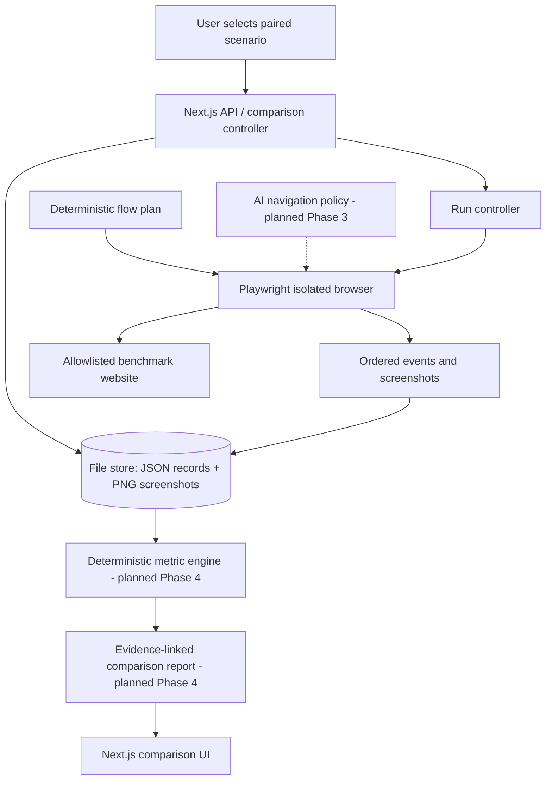

# ChoiceMirror — Architecture

**Version:** 0.2 · **Status:** Phase 2 implemented (browser runner, storage, APIs, evidence UI); AI policy and metrics modules remain target design for Phases 3–4

## Architectural principle
Keep the **AI navigation policy**, **browser actuator**, **deterministic event capture**, and **evaluation/reporting** as independently testable modules. Build the smallest deployable system that can show an honest, repeatable paired test.

## High-level flow


## Run lifecycle (Phase 2 as shipped)
1. Client posts `scenarioId` and two opposing `goalIds`; the server validates them against the catalog and creates a `comparisonId`, then answers `202` (or `400` invalid / `429` while another run is active).
2. The run controller executes Goal A then Goal B sequentially, each in a fresh isolated Playwright context with a fixed viewport, the shared seed, and cleared storage — equivalent starting conditions by construction.
3. Each journey opens the fixture at the allowlisted `BENCHMARK_ORIGIN`, records the non-counting goal selection, executes the documented flow-step clicks, and captures ordered events plus screenshot checkpoints.
4. Fixed limits (max actions, step timeout, journey timeout) stop runaway runs with `timeout`, `blocked`, or `failed` states; browser resources are always released, including on failure.
5. Journeys and screenshots are persisted incrementally, so partial evidence survives a mid-run failure; the comparison finishes `completed` or `failed`.
6. The UI polls `GET /api/comparisons/:id` while `running` and renders per-goal panels: status badge, action counts, ordered events, and screenshots.
7. Planned Phase 3–4: AI-proposed actions behind policy guards, a deterministic metrics engine, and evidence-linked findings.

## Proposed stack
| Layer | Choice | Reason |
|---|---|---|
| Language | TypeScript, strict mode | Shared contracts and rapid development |
| Web app | Next.js App Router + React | Dashboard, API and benchmark UI |
| Styling | Tailwind CSS | Accessible, consistent design system |
| Visualizations | Recharts or custom SVG | Evidence-centred comparison |
| Browser | Playwright | Isolated contexts and screenshot capture |
| AI | Provider-neutral adapter using one selected API with JSON schema output — **planned Phase 3** | Auditable, swappable structured action policy |
| Validation | Zod | Runtime contracts for model output and API |
| Storage | File-backed JSON records + PNG screenshots behind `ComparisonStore` (SQLite swap-ready) | No database setup; persistence isolated behind one interface |
| Testing | Vitest + Playwright tests | Unit and end-to-end fixture replay |
| CI | GitHub Actions | Typecheck, lint and tests |
| Hosting | Deploy UI where supported; separately host a Playwright-capable worker if required | Serverless browsers may not run reliably |

**Important:** service selection must be confirmed before implementation. Do not promise persistent SQLite or Playwright support on incompatible serverless hosting. Local execution with documented commands is the reliable fallback.

## Monorepo structure (Phase 2 as shipped)
```text
choiceMirror/
├── README.md
├── docs/
│   ├── PRD.md
│   ├── Architecture.md
│   ├── Rules.md
│   ├── Phases.md
│   ├── Design.md
│   └── Memory.md
├── package.json
├── pnpm-workspace.yaml
├── .env.example
├── .gitignore
├── apps/
│   ├── web/
│   │   ├── app/
│   │   │   ├── page.tsx
│   │   │   ├── comparisons/[id]/page.tsx
│   │   │   └── api/comparisons/           # start, status, artifact routes
│   │   ├── components/
│   │   └── lib/                           # store access + run controller
│   └── benchmark/
│       ├── app/
│       └── fixtures/
├── packages/
│   ├── contracts/         # Zod API, evidence, and journey-plan schemas
│   ├── browser-runner/    # deterministic Playwright action executor
│   ├── storage/           # file-backed ComparisonStore adapters
│   ├── agent/             # observation, planning, policy guards — planned Phase 3
│   └── metrics/           # deterministic measures and explanations — planned Phase 4
├── tests/
│   └── e2e/               # two-server Playwright acceptance tests
└── .github/workflows/ci.yml
```
Structure updates here as implementation feedback arrives; `agent/` and `metrics/` are planned, not yet scaffolded.

## Suggested core entities
Shipped schemas live in `packages/contracts` (`ComparisonRecord`, `JourneyRecord`, `TraceEvent`):
- `Comparison`: id, scenarioId, goalIds, seed, status, createdAt, completedAt, error.
- `JourneyRun`: id, comparisonId, goalId, status, seed, origin, viewport, expectedActionCount, actionCount, timestamps, events, screenshots, error.
- `TraceEvent`: stepNo, timestamp, type, label, outcome, countsAsAction, detail, screenshotId.

Planned entities (Phases 3–4, not yet implemented):
- `MetricSet`: completion, actionCount, navigationCount, backtrackCount, interruptionCount, wallTimeMs, unknownFields.
- `Finding`: category, statement, supportingTraceEventIds, confidence, caveats.

Never persist model reasoning as fact; store brief model-provided action justification and measured events separately.

## API (as shipped in Phase 2)
- `GET /api/scenarios`: list controlled fixtures.
- `POST /api/comparisons`: validate `{scenarioId, goalIds}` against the catalog and start a bounded paired run → `202 {comparisonId, status:"running"}`; `400` for invalid requests; `429` while another comparison is running (single-flight guard).
- `GET /api/comparisons/:id`: `{comparison, journeys}` validated against `comparisonDetailSchema`; `404` for unknown, corrupt, or traversal ids.
- `GET /api/comparisons/:id/artifacts/:artifactId`: stored `image/png` screenshot bytes with `Cache-Control: private, max-age=300`; `404` otherwise. There is deliberately **no** endpoint that navigates to an arbitrary URL.
- Model-provider endpoints and metrics endpoints are planned for Phases 3–4. The MVP stays a single server process; do not create unnecessary distributed infrastructure.

## Security / isolation
- Allowlist full origin(s), validate redirects before following, block arbitrary user-provided URLs in MVP.
- Dedicated test browser without real credentials, storage or extensions.
- No shell tool exposed to AI; typed click, input, scroll and stop only; sensitive or externally impactful actions blocked.
- Sanitize model/page text as untrusted content; DOM instructions cannot override system policy.
- Cap requests, action steps, per-run time and estimated API spend.
- Store API secrets server-side; use fake accounts and synthetic fixture data only.

## Observability and reproducibility
Log scenario and fixture version, viewport, seed, action parameters, environment version, model/provider and model settings. Capture structured JSONL traces and artifacts. Re-run identical fixtures and compare actual events; log mismatches rather than hiding them.

## Boundaries / deployment
A deployed dashboard does not constitute a live working run unless the browser worker and API actually operate. Prefer demonstrable local MVP over a public UI that displays fabricated results.
