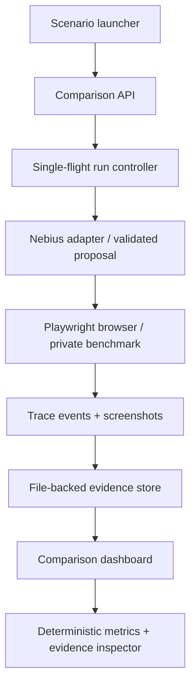

# ChoiceMirror — technical architecture

ChoiceMirror is a two-journey browser comparison service. It measures the interaction burden for **both sides** of a controlled digital choice and links every finding to real browser events and screenshots.

**Live demo:** https://choicemirror-production.up.railway.app  
**Runtime:** Next.js, Node.js 25, Playwright Chromium and Nebius Token Factory  
**Model:** `zai-org/GLM-5.3-Flash` (server-side; model output is not itself a verdict)

## System overview

The comparison API accepts only scenario identifiers and ordered goals from the checked-in catalog. It cannot navigate to user-entered URLs.

### Components

| Component | Source | Responsibility |
| --- | --- | --- |
| Web app | `apps/web` | Scenario launcher, APIs, public guardrails and comparison dashboard |
| Synthetic benchmark | `apps/benchmark` | Balanced/asymmetric membership and consent fixtures |
| Contracts | `packages/contracts` | Scenario IDs, Zod schemas, action policy and typed trace evidence |
| Nebius adapter | `packages/agent` | Versioned prompt, bounded provider calls, structured action parsing |
| Browser runner | `packages/browser-runner` | Isolated Playwright sessions, allowed-origin requests and event/screenshot capture |
| Metrics | `packages/metrics` | Pure event counts, paired comparisons, findings and evidence validation |
| Storage | `packages/storage` | File-backed comparison records, journeys and PNG screenshots |

## Execution lifecycle

1. A browser client submits `{scenarioId, goalIds, mode}` to `POST /api/comparisons`; the API validates the complete scenario/goal mapping against the catalog.
2. A synchronous **single-flight reservation** rejects a simultaneous second run with HTTP 429.
3. In public mode, a **persisted usage gate** checks daily global, AI-specific and per-visitor quotas before a comparison is saved or model work begins.
4. The runner opens a new isolated Chromium context for each goal, with fixed viewport and benchmark starting state.
5. In **AI mode**, Nebius receives a bounded observation and proposes a structured `click` or `stop`. Zod and a fixed policy validate the proposal before Playwright is allowed to click the corresponding observed element. In deterministic mode, an approved action plan is replayed without model calls.
6. The system records the actual trace and PNG screenshot at each checkpoint and saves each journey independently. A failed second journey cannot erase the first.
7. The metrics package calculates paired action counts only if **both** journeys completed under matching conditions. Stored event/screenshot references are checked before a finding can be treated as evidence-complete.
8. The dashboard exposes the result, current status, screenshots and model-reported explanations with separate labels.

**Action-count semantics:** Goal selection and navigation do not count as user actions. A counted action is a successful recorded interaction; repeated trace entries cannot inflate the count.

## API

| Route | Method | Result |
| --- | --- | --- |
| `/api/scenarios` | GET | Controlled scenario catalog |
| `/api/comparisons` | POST | Starts a validated comparison; 202 or explicit 400/403/429/503 |
| `/api/comparisons/:id` | GET | Schema-validated comparison and journeys |
| `/api/comparisons/:id/artifacts/:artifactId` | GET | Actual stored PNG evidence with validated identifiers |
| `/api/health` | GET | Web and benchmark readiness; reports 503 if public mode lacks key or mounted storage |

No public endpoint exposes the Nebius key, accepts arbitrary URLs, or directly proxies raw model requests.

## Safety boundaries

- Playwright is constrained to the exact configured benchmark origin. Off-origin subresources, page fetches and redirect chains are blocked; service workers are disabled.
- Model actions are restricted to validated, observed DOM controls. There is no free-form JavaScript, shell execution, text submission, account access, or model-driven URL navigation.
- Runtime caps: **10 counted actions**, **12 AI decisions**, **6 rejected AI proposals**, **60-second journey timeout**, **10-second step timeout** and bounded model requests/token budgets.
- An unconfigured or failed AI run never silently changes to deterministic mode.
- Evidence types distinguish **observed browser events**, **calculated metrics**, and **model-reported explanations**.
- Missing, partial, corrupt or incomparable records produce **inconclusive**, not an invented finding.

## Public deployment

The production service runs on Railway using the root Docker image and [start script](../scripts/start-public-demo.mjs). One public Next.js server listens on Railway's injected `PORT`; the benchmark listens only at `127.0.0.1:3001`. The web server's Playwright jobs access the benchmark internally.

**Production configuration:** one replica, persistent volume mounted at `/data`, `CHOICEMIRROR_DATA_DIR=/data`, and a private `NEBIUS_API_KEY` in Railway Variables. Browser connections use the public HTTPS domain. The current domain targets **container port 8080**.

The storage directory also contains the **UTC-day quota state**, written before accepting each run. The file-backed quota and single-process reservation are intentionally **not horizontally scalable**. Multiple replicas would require a transactional shared datastore and distributed job queue.

See [Railway operations](submission/PUBLIC_DEMO_DEPLOYMENT.md) and [security review](submission/SECURITY_REVIEW.md) for deployment checks and limitations.

## Verification

`pnpm typecheck`, `pnpm lint`, `pnpm test:unit`, `pnpm test:e2e` and `pnpm build` run in CI without API credits. A dedicated [Docker smoke workflow](../.github/workflows/public-demo-smoke.yml) exercises the container, Playwright Chromium, a complete deterministic comparison, same-origin checks, and persistent quota denial. Live model evaluation is opt-in and documented in [LIVE_TEST_RESULTS.md](submission/LIVE_TEST_RESULTS.md).
