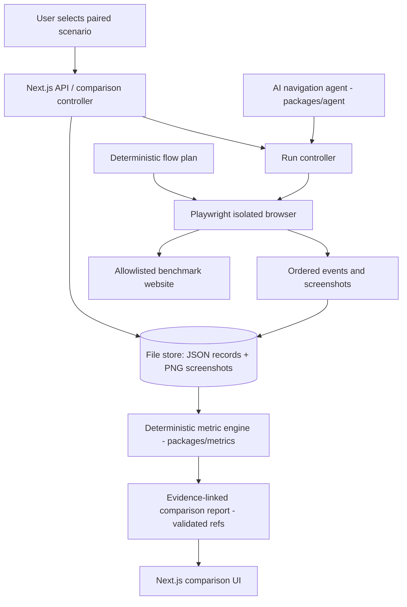
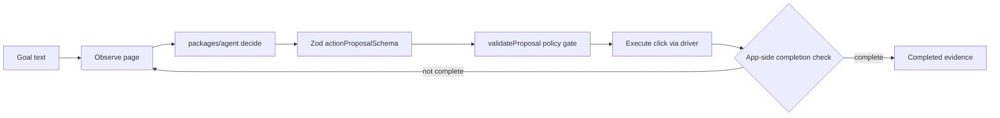
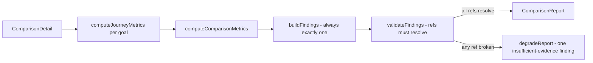

# ChoiceMirror — Architecture

**Version:** 0.4 · **Status:** Phase 4 implemented (pure metrics engine, evidence-linked findings, mirrored dashboard with evidence inspector and methodology panel); Phase 5 (validation and submission) remains

## Architectural principle
Keep the **AI navigation policy**, **browser actuator**, **deterministic event capture**, and **evaluation/reporting** as independently testable modules. Build the smallest deployable system that can show an honest, repeatable paired test.

## High-level flow


## Run lifecycle (Phases 2–3 as shipped)
1. Client posts `scenarioId` and two opposing `goalIds`; the server validates them against the catalog, **atomically reserves the single in-process run slot before its first `await`**, and answers `202 {comparisonId, status:"running"}` (`400` for invalid requests; `429` when the slot is already taken — the reservation is released on every failure path).
2. The run controller executes Goal A then Goal B sequentially, each in a fresh isolated Playwright context with a fixed viewport, the shared seed, and cleared storage — equivalent starting conditions by construction.
3. Each journey opens the fixture at the trusted `BENCHMARK_ORIGIN` behind the fail-closed request interceptor (see Security), records the non-counting goal selection, executes the documented flow-step clicks, and captures ordered events plus screenshot checkpoints.
4. Fixed limits (max actions, step timeout, journey timeout) stop runaway runs with `timeout`, `blocked`, or `failed` states; browser resources are always released, including on failure.
5. Journeys and screenshots are persisted incrementally, so partial evidence survives a mid-run failure; the comparison finishes `completed` or `failed`.
6. The UI polls `GET /api/comparisons/:id` while `running` and renders the dashboard: status banner, main finding with an inspect-evidence action, metric cards, mirrored Goal A/B tracks, evidence inspector, and methodology panel.
7. Phase 3 (shipped): with `mode: "ai"` the controller creates a fresh `NavigationAgent` per journey and `runAiJourney` loops observe → decide → validate → execute → app-side completion check (see below). Deterministic mode remains the default and is explicitly labelled; an unconfigured AI run fails with the server's reason instead of falling back.
8. Phase 4 (shipped): `buildComparisonReport` derives a schema-valid `ComparisonReport` (metrics + exactly one finding + evidence validation) from stored evidence — pure, deterministic, no persistence, no model call.

## AI navigation (Phase 3 as shipped)
`packages/agent` is the provider adapter; `runAiJourney` in `packages/browser-runner` owns the loop. The deterministic path is unchanged — AI mode is an explicit, labelled opt-in from the launcher.



- **Adapter (`packages/agent`):** `config` reads `NEBIUS_API_KEY`, `NEBIUS_BASE_URL`, `NEBIUS_MODEL` server-side only (defaults: `https://api.tokenfactory.nebius.com/v1`, `zai-org/GLM-5.3-Flash`); `prompt` is a byte-constant system prompt (version `phase3-v1`) with goal, observation, and rejection feedback travelling only in the user message; `client` is a typed `fetch` with a 20s per-call timeout, 2 bounded transient retries, an error taxonomy (auth, credits, model-unavailable, rate-limit, timeout, network, malformed, budget, api) and token accounting; `agent` turns one `DeciderInput` into one validated `ActionProposal`.
- **Observation pipeline:** the Playwright driver collects raw page state (origin-checked URL, title, headings, visible buttons/links with accessible names and enabled state, bounded page text) → the pure `buildObservation` bounds, redacts PII-shaped values, and assigns stable `element-N` ids → only that `PageObservation` reaches the model, inside a delimited untrusted block. Raw HTML never travels.
- **Action validation:** a proposal must pass Zod `actionProposalSchema` (only `click` with an `element-N` target, or `stop`) and then `validateProposal` (target exists in the observation, is enabled, and — during goal selection — must be this journey's own goal button) before the driver may execute it. Invalid proposals get a small fixed rejection budget with recorded feedback; the app, never the model, decides completion.
- **Limits and budgets:** 12 decisions and 6 rejected proposals per journey, 50k tokens per journey, 2048 output tokens per call (raised from the planned 300 after live evidence: the reasoning model needs >1200 reasoning tokens before emitting its action), temperature 0; journeys stay bounded by the existing action/step/journey limits and always release the browser.
- **Evidence:** `comparison.mode` (`deterministic` | `ai`; optional so Phase 2 records stay valid), a per-journey `ai` block (provider, model, prompt version, inference-call count, input/output tokens, rejected proposals, model errors) and a per-event `ai` block (observation reference, proposed action, validation result, model-reported justification, outcome, usage, latency). Model statements are rendered as *model-reported*, never as verified fact.
- **Live evaluation:** `pnpm test:live` (`playwright.live.config.ts` + `tests/live/ai-eval.spec.ts`) runs all eight journeys against the real API only when `NEBIUS_LIVE=1` and `NEBIUS_API_KEY` are both set; `test:e2e` and CI stay credential-free against the local mock model on port 3099.

## Metrics, findings and dashboard data flow (Phase 4 as shipped)
`packages/metrics` is a **pure** package: no I/O, no persistence, no clock reads (durations parse stored timestamps), no model call. A function-per-stage pipeline composes the report:



- **Stages:** `computeJourneyMetrics` (per goal, `undefined` journey → honest `pending` metrics), `computeComparisonMetrics` (journeys mapped via `comparison.goalIds`, never array order), `buildFindings`, `validateFindings`, composed by `buildComparisonReport`. Every stage is typed by Zod (`journeyMetricsSchema`, `comparisonMetricsSchema`, `findingSchema`, `comparisonReportSchema`) and tested with hand-built fixtures independent of the runner.
- **Honest-number rules:** `actionDifference`/`heavierJourney`/`actionRatio` exist only when **both** journeys completed with recorded counts; the ratio is `(max+1)/(min+1)` (PRD §9); unobservable values are `null` and render as "Not available" — never `0`; `result` is `balanced`, `observed-asymmetry`, or `inconclusive` with human-readable comparability reasons (mismatched seed/origin/viewport/mode, non-completion). Comparison `completed` never implies both journeys succeeded.
- **Findings:** deterministic — one finding per report, evidence-bounded copy with `observed`/`calculated`/`interpreted` separated, no verdict language in title or explanation (the disclaimer lives only in `limitations`). Every cited `journeyId`, `stepNo`, and `screenshotId` must resolve against stored evidence; if any reference is broken (corrupt storage), `degradeReport` returns a single `insufficient-evidence` finding and the dashboard shows a validation strip — never fabricated references.
- **Dashboard data flow:** the comparison page derives the report server-side at render, and the client's status poll recomputes the **same pure function** on each fetched detail — identical output on both paths, no report endpoint, no stored report (D-023).
- **Contrast:** `apps/web/lib/contrast.test.ts` reads `globals.css` and pins WCAG AA ratios (4.5:1 body text, 4.5:1 tinted badges after compositing, 3:1 journey accents) so token drift fails the unit gate.

## Proposed stack
| Layer | Choice | Reason |
|---|---|---|
| Language | TypeScript, strict mode | Shared contracts and rapid development |
| Web app | Next.js App Router + React | Dashboard, API and benchmark UI |
| Styling | Tailwind CSS | Accessible, consistent design system |
| Visualizations | Recharts or custom SVG | Evidence-centred comparison |
| Browser | Playwright | Isolated contexts and screenshot capture |
| AI | `packages/agent`: typed-fetch Nebius Token Factory adapter (OpenAI-compatible chat completions) with structured JSON action proposals — **shipped Phase 3**; `response_format` deliberately omitted pending live verification | Auditable, swappable structured action policy |
| Validation | Zod | Runtime contracts for model output and API |
| Storage | File-backed JSON records + PNG screenshots behind `ComparisonStore` (SQLite swap-ready) | No database setup; persistence isolated behind one interface |
| Testing | Vitest + Playwright tests | Unit and end-to-end fixture replay |
| CI | GitHub Actions | Typecheck, lint and tests |
| Hosting | Deploy UI where supported; separately host a Playwright-capable worker if required | Serverless browsers may not run reliably |

**Important:** service selection must be confirmed before implementation. Do not promise persistent SQLite or Playwright support on incompatible serverless hosting. Local execution with documented commands is the reliable fallback.

## Monorepo structure (Phase 2 as shipped)
```text
choiceMirror/
├── README.md
├── docs/
│   ├── PRD.md
│   ├── Architecture.md
│   ├── Rules.md
│   ├── Phases.md
│   ├── Design.md
│   └── Memory.md
├── package.json
├── pnpm-workspace.yaml
├── .env.example
├── .gitignore
├── apps/
│   ├── web/
│   │   ├── app/
│   │   │   ├── page.tsx
│   │   │   ├── comparisons/[id]/page.tsx
│   │   │   └── api/comparisons/           # start, status, artifact routes
│   │   ├── components/
│   │   └── lib/                           # store access + run controller
│   └── benchmark/
│       ├── app/
│       └── fixtures/
├── packages/
│   ├── contracts/         # Zod API, evidence, and journey-plan schemas
│   ├── browser-runner/    # deterministic + AI Playwright journey executors
│   ├── storage/           # file-backed ComparisonStore adapters
│   ├── agent/             # Nebius adapter: config, prompt, client, agent (Phase 3)
│   └── metrics/           # pure metrics, findings, evidence validation (Phase 4)
├── tests/
│   ├── e2e/               # two-server Playwright acceptance tests + mock model
│   └── live/              # opt-in live Nebius evaluation (`pnpm test:live`)
└── .github/workflows/ci.yml
```
Structure updates here as implementation feedback arrives; `packages/metrics` shipped in Phase 4 and is consumed only by the web app's comparison page.

## Suggested core entities
Shipped schemas live in `packages/contracts` (`ComparisonRecord`, `JourneyRecord`, `TraceEvent`):
- `Comparison`: id, scenarioId, goalIds, seed, status, mode (`deterministic` | `ai`, optional for pre-Phase-3 records), createdAt, completedAt, error.
- `JourneyRun`: id, comparisonId, goalId, status, seed, origin, viewport, expectedActionCount, actionCount, timestamps, events, screenshots, error, ai (optional model-reported summary: provider, model, prompt version, inference calls, tokens, rejected proposals, model errors).
- `TraceEvent`: stepNo, timestamp, type, label, outcome, countsAsAction, detail, screenshotId, ai (optional: observationRef, proposed action, validation, model-reported justification, usage, latency).

Shipped reporting entities (Phase 4, `packages/metrics/src/schemas.ts`):
- `JourneyMetrics`: journeyId, goalId, outcome (`completed` | `failed` | `blocked` | `timed-out` | `pending`), actionCount (unique successful `click` events flagged `countsAsAction` — one shared `isCountedAction` predicate with citations and UI, D-030), navigationEventCount, durationMs, ai (nullable inference-call/token summary), evidence (trace and screenshot completeness). Unobservable values are `null`, never `0`.
- `ComparisonMetrics`: journeys as a tuple in `comparison.goalIds` order, actionDifference, heavierJourney, actionRatio (`(max+1)/(min+1)`) — all three `null` unless both journeys completed with counts **under matching conditions** (no comparability reasons, D-029) — comparableConditions (flag + human-readable reasons), result (`balanced` | `observed-asymmetry` | `inconclusive`). A degraded report is always `inconclusive` with the comparative fields null while per-journey counts survive (D-029).
- `Finding`: id, category, title, explanation, observed[], calculated[], interpreted, evidence[{journeyId, stepNos, screenshotIds}], limitations[], quality (`evidence-complete` | `evidence-partial` | `insufficient-evidence`).
- `ComparisonReport`: metrics + exactly one finding + validation. Deliberately **not persisted** — derived on render (D-023).

PRD §9 also names backtracking, interruptions, and human takeover; the trace format cannot prove them, so they are reported as not captured in limitations (never as `0`) — see D-027.

Never persist model reasoning as fact; store brief model-provided action justification and measured events separately.

## API (as shipped in Phase 2)
- `GET /api/scenarios`: list controlled fixtures.
- `POST /api/comparisons`: validate `{scenarioId, goalIds}` against the catalog and start a bounded paired run → `202 {comparisonId, status:"running"}`; `400` for invalid requests; `429` while another comparison is running (atomic single-flight reservation taken before the first `await` and released on every failure path).
- `GET /api/comparisons/:id`: `{comparison, journeys}` validated against `comparisonDetailSchema`; `404` for unknown, corrupt, or traversal ids.
- `GET /api/comparisons/:id/artifacts/:artifactId`: stored `image/png` screenshot bytes with `Cache-Control: private, max-age=300`; `404` otherwise. There is deliberately **no** endpoint that navigates to an arbitrary URL.
- There are deliberately **no** model-provider endpoints: inference runs inside the server process with the key read from the environment (never sent to the browser, never logged). There are deliberately **no** metrics endpoints either: the comparison report is derived from the existing `GET /api/comparisons/:id` payload by the pure `@choicemirror/metrics` pipeline on every render (D-023). The MVP stays a single server process; do not create unnecessary distributed infrastructure.

## Security / isolation
- **Request-layer origin guard (shipped):** a fail-closed `context.route` handler is installed before any page exists; every request must match the exact trusted origin or it is aborted in the browser before a byte leaves. Service workers are blocked so the interceptor is the only path to the network. Because Playwright routes only the first request of a redirect chain (microsoft/playwright#34994) and native redirect hops do not re-enter the handler, chains are walked hop-by-hop with `route.fetch({maxRedirects:0})` and aborted at the first off-origin target. Responses are delivered with `route.continue()`, never `route.fulfill()` — fulfilling a document leaves byte-identical HTML yet silently breaks Next.js hydration (React never attaches), while fetch-then-continue hydrates. Blocked URLs are recorded without query strings, and any violation marks the journey `blocked`. Covered by `tests/e2e/origin-guard.spec.ts` (subresource, single-hop redirect, multi-hop chain — each asserting zero hits on the external server).
- Allowlist full origin(s), block arbitrary user-provided URLs in MVP.
- Dedicated test browser without real credentials, storage or extensions.
- The model may propose only `click` (on an observed, enabled element) or `stop`; there is no shell, JavaScript execution, typing, free-text input, URL navigation, or browser configuration anywhere in the action surface, and every proposal passes Zod schema validation plus the `validateProposal` policy gate before it can reach the driver.
- Model and page text are untrusted: page text travels only inside a delimited untrusted block of the user message under a byte-constant system prompt, and a controlled prompt-injection E2E test proves injected page instructions can neither complete the journey nor escape the origin.
- Cap requests, action steps, per-run time, model decisions (12), rejected proposals (6), tokens per journey (50k), transient retries (2) and per-call timeout (20s); an unconfigured AI run fails with the server's reason rather than falling back silently.
- Store API secrets server-side; use fake accounts and synthetic fixture data only.

## Observability and reproducibility
Log scenario and fixture version, viewport, seed, action parameters, environment version, model/provider and model settings. Capture structured JSONL traces and artifacts. Re-run identical fixtures and compare actual events; log mismatches rather than hiding them.

## Boundaries / deployment
A deployed dashboard does not constitute a live working run unless the browser worker and API actually operate. Prefer demonstrable local MVP over a public UI that displays fabricated results.
